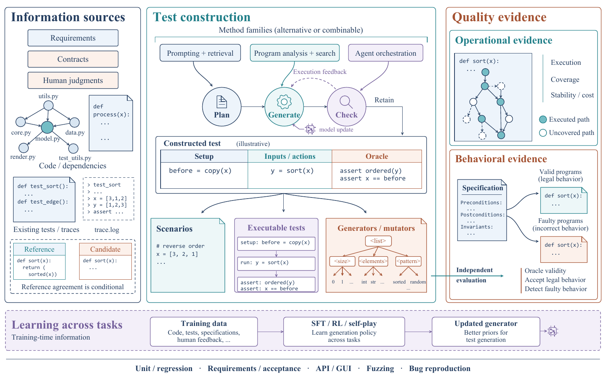

# LLM-Based Test Generation Survey

Research materials for **LLM-Based Test Generation: Information Sources, Generation Strategies, and Quality Evidence**.

This repository connects testing objectives and generated artifacts with information access, generation mechanisms, and the evidence used to evaluate test quality. It covers unit and requirements-based testing, test oracles, API/GUI testing, fuzzing, bug reproduction, and learned test generators.

## Read the collection

- [Literature register](papers.md): 60 source records, grouped by topic, with primary-source links, analytical notes, and inspection depth.
- [CSV register](data/papers.csv): the same 60 records in a filterable format.
- [Bibliography](manuscript/references.bib): citation keys correspond to source IDs in the register.
- [Search and verification notes](search-notes.md): search families, inspected passages, source restrictions, and coverage gaps.
- [Review outline](docs/survey-plan.md): research questions and the proposed synthesis structure.
- [Survey manuscript](manuscript/main.pdf): the current 21-page English draft.
- [Manuscript and figure build instructions](manuscript/README.md).

## Current research status

The collection was assembled through **28 September 2026**. It contains seven surveys/roadmaps and 53 method, benchmark, empirical, and historical records. It is a preliminary curated collection supporting a **structured narrative survey**, not a completed systematic literature review or an exhaustive population of studies.

The register distinguishes abstract/metadata inspection from selected full-text inspection. Independent dual screening, complete variant-level extraction, inter-rater validation, and experimental reproduction have not been completed. No cross-paper performance ranking or pooled effect size is claimed. See [research status and review access](docs/research-status.md).

## Figures

The current main figure is a native vector reconstruction with embedded PDF fonts and editable SVG text and geometry.



- [Main figure: PDF](manuscript/figures/construction-overview-illustrated.pdf) / [SVG](manuscript/figures/construction-overview-illustrated.svg)
- [Representative literature map: PDF](manuscript/figures/literature-map.pdf) / [SVG](manuscript/figures/literature-map.svg)
- [Quality evidence: PDF](manuscript/figures/quality-evidence.pdf) / [SVG](manuscript/figures/quality-evidence.svg)

The figures are conceptual syntheses and illustrative examples. The literature map displays selected examples, not research-frequency statistics.

## Rebuild and maintain

See [build instructions](manuscript/README.md). The CSV can be regenerated from `papers.md`:

```bash
python scripts/export_register.py
```

The export checks that the literature IDs agree with the bibliography and that the current collection has 60 unique records. It does not establish the scientific correctness of the classifications.

## Review distribution

This is the public GitHub repository. A separate anonymous review-access endpoint has not yet been configured. Use an anonymized snapshot for double-anonymous submission, and update the manuscript's Data Availability statement with the actual anonymous URL once it exists. Do not use this author-identifying GitHub URL as the review link.

## Attribution

Paper titles, source URLs, and bibliographic records identify their original authors and publications. The repository provides a linked literature register; it does not redistribute third-party paper PDFs. The bundled ACM template files retain their [original license](manuscript/LICENSE). See [third-party attribution](docs/third-party-notices.md).

## 中文说明

本仓库整理 LLM 测试生成相关文献、检索与核验记录、综述初稿和可编辑矢量图。60 条记录是初步调研集合，逐条保留检查深度；尚未完成系统综述的独立筛选、全文编码和实验复现。`papers.md` 适合阅读，`data/papers.csv` 适合筛选整理，`manuscript/` 提供论文及重建材料。
